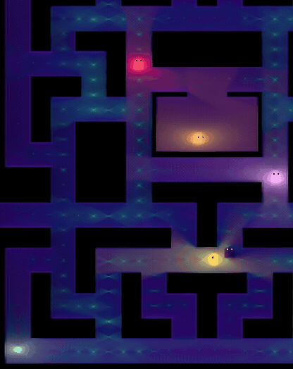
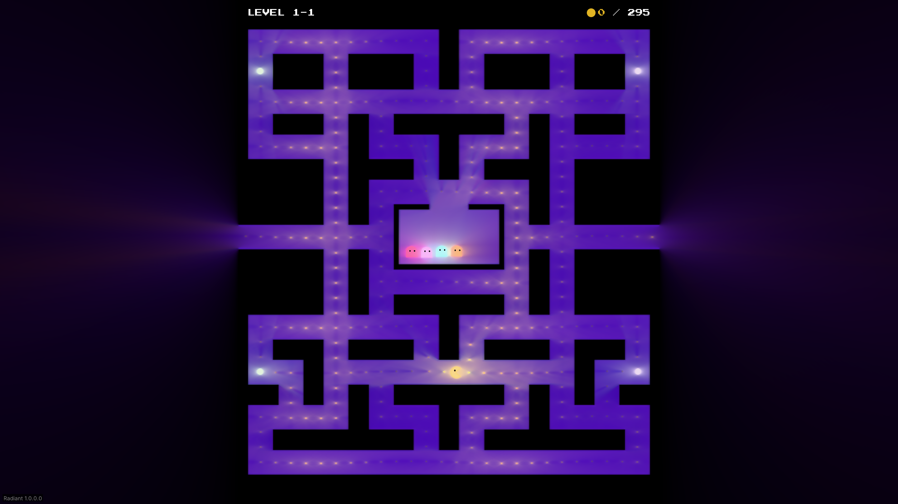
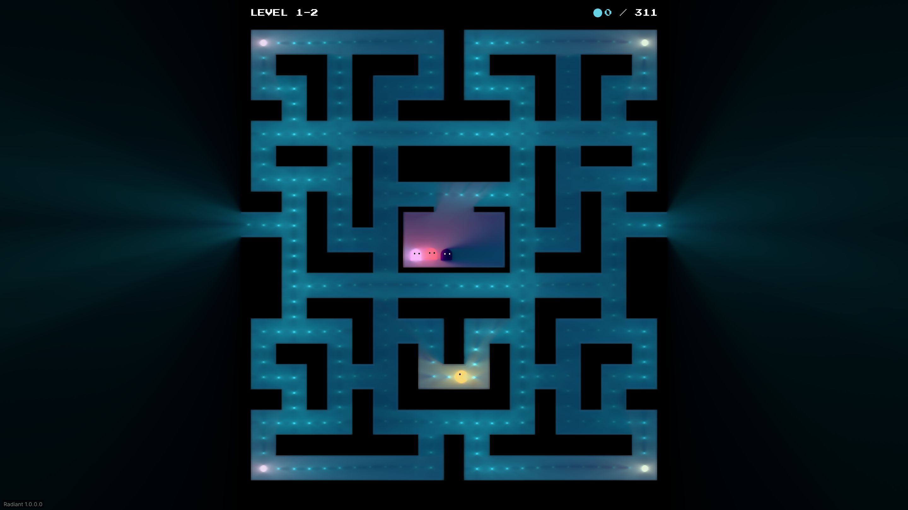
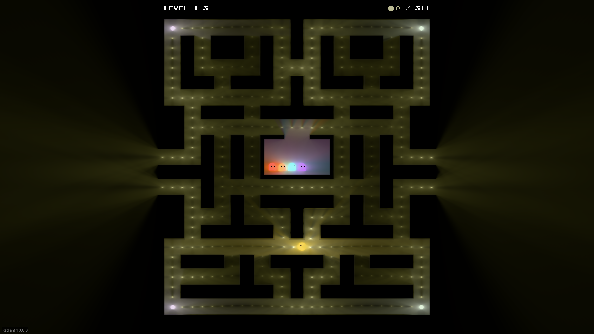
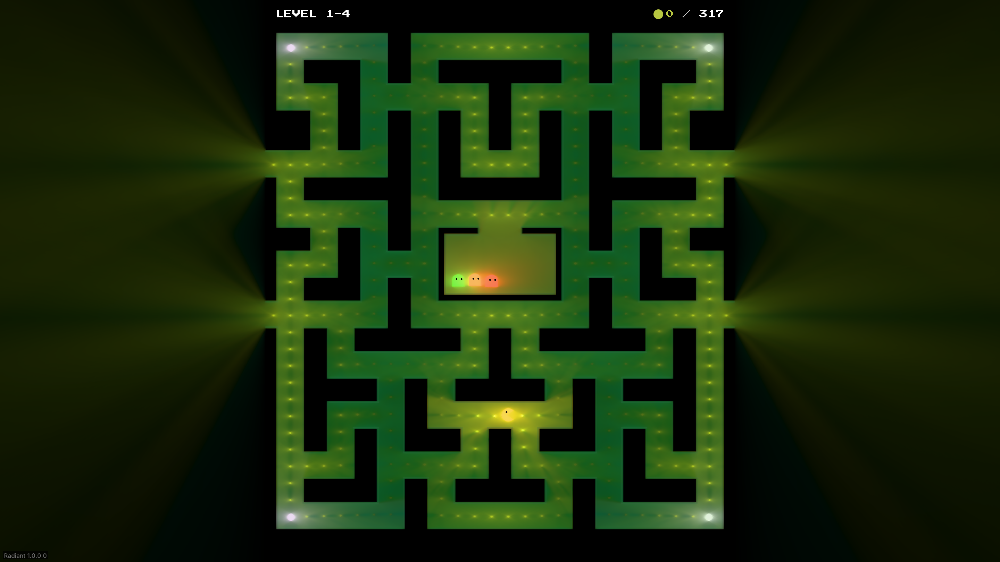
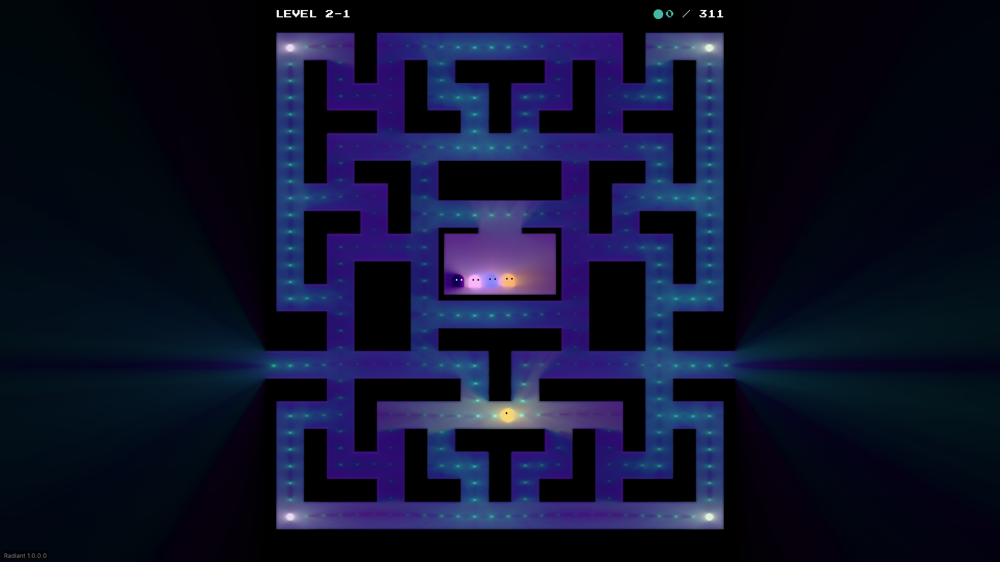
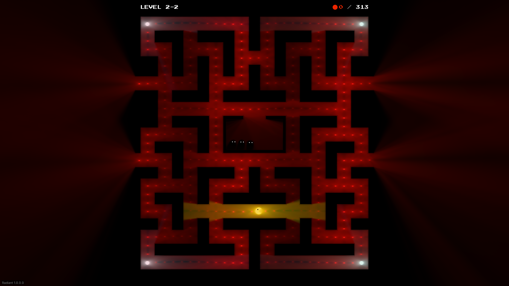
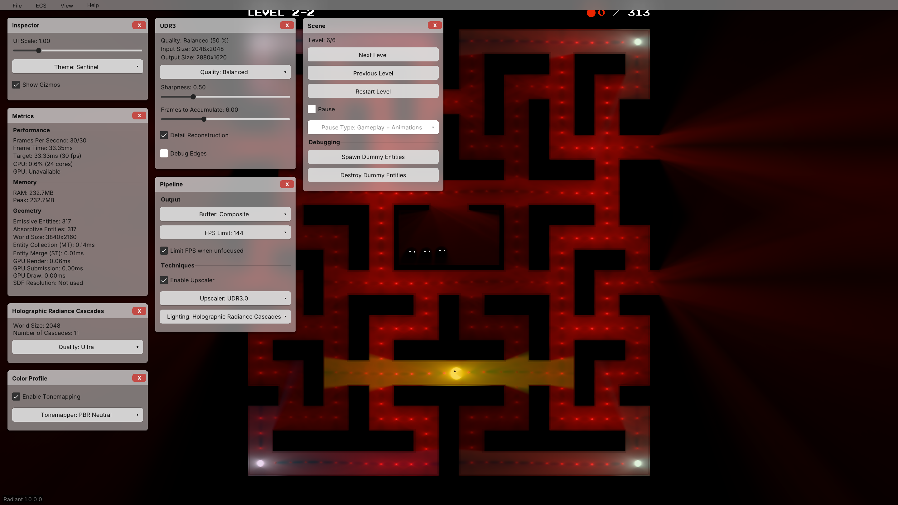

<h1 align="center">Raytracing Pac-Man</h1>

<p align="center">
  <a href="https://github.com/lestercorderomurillo/raytracing-pacman/releases/tag/v0.1.1"></a>
  
</p>

[](docs/screenshots/gameplay-maximized.png)

Collect every coin to advance. Power pellets let you eat frightened ghosts; getting caught restarts the level.

- **Six levels:** a classic maze and five seeded layouts with different colors and ghost lineups.
- **Seven ghost types:** Blinky, Pinky, Inky, Clyde, Dinky, Shadow, and Rainbow.
- **Dynamic lighting:** glowing walls, ghosts, coins, and power pellets.

## Play

**[Download v0.1.1 for Linux x64](https://github.com/lestercorderomurillo/raytracing-pacman/releases/download/v0.1.1/raytracing-pacman-v0.1.1-linux-x64.tar.gz)** · [Release notes](https://github.com/lestercorderomurillo/raytracing-pacman/releases/tag/v0.1.1)

```sh
tar -xzf raytracing-pacman-v0.1.1-linux-x64.tar.gz
cd raytracing-pacman-v0.1.1-linux-x64
./raytracing-pacman
```

Requires Linux x64, Vulkan graphics drivers, and a graphical desktop. Keep the bundled runtime and assets with the executable.

## Controls

[](docs/controls.png)

## Ghosts

| Ghost | In game |
| --- | --- |
| **Blinky** — Direct pursuit; retreats to the upper-right corner. |  |
| **Pinky** — Direct pursuit; retreats to the upper-left corner. |  |
| **Inky** — Direct pursuit; retreats to the lower-right corner. |  |
| **Clyde** — Chases from afar; retreats when Pac-Man gets close. |  |
| **Dinky** — Heads for random corners when Pac-Man gets close. |  |
| **Shadow** — Dark body; moves up to 50% faster. |  |
| **Rainbow** — Splits into three color-changing ghosts, then merges back into one. |  |

## Levels

| Level | In game |
| --- | --- |
| **1-1** | [](docs/screenshots/level-1.png) |
| **1-2** | [](docs/screenshots/level-2.png) |
| **1-3** | [](docs/screenshots/level-3.png) |
| **1-4** | [](docs/screenshots/level-4.png) |
| **2-1** | [](docs/screenshots/level-5.png) |
| **2-2** | [](docs/screenshots/level-6.png) |

## Editor

Press **F1**, then choose **View → Show All** to display every editor panel.

[](docs/screenshots/editor-show-all.png)

[Build and test instructions](BUILD.md). Built with [Radiant](https://github.com/lestercorderomurillo/radiant-game-engine) and MonoGame DesktopVK.
