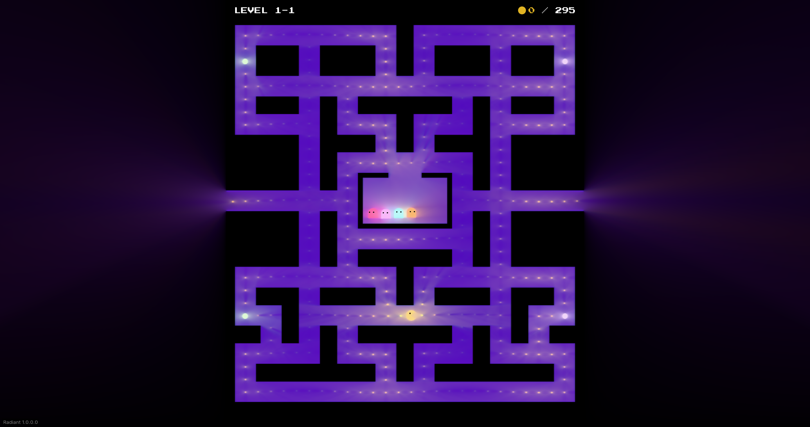
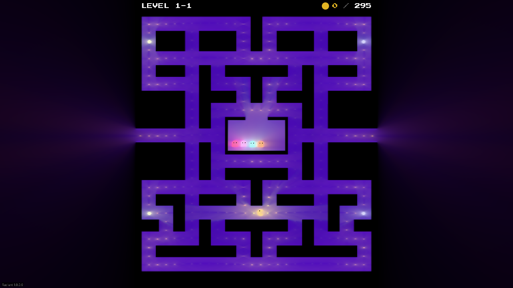

<h1 align="center">Raytracing Pac-Man</h1>

<p align="center">
  <strong>Classic maze chasing, lit by radiance cascades.</strong><br>
  Built with <a href="https://github.com/lestercorderomurillo/radiant-game-engine">Radiant</a> and MonoGame DesktopVK.
</p>

<p align="center">
  
  
  
</p>

<p align="center">
  <a href="#quick-start">Quick start</a> ·
  <a href="#controls">Controls</a> ·
  <a href="#project-layout">Project layout</a> ·
  <a href="#development">Development</a> ·
  <a href="#checks">Checks</a>
</p>

[](docs/screenshots/gameplay-maximized.png)

<p align="center">
  <sub>Actual Linux gameplay · Vulkan · Native rendering · 2880 × 1521</sub>
</p>

| In the game | What to explore |
| --- | --- |
| **Six levels** | A classic maze and seeded procedural layouts, with different palettes and ghost lineups. |
| **Seven ghost types** | Blinky, Pinky, Inky, Clyde, Dinky, Shadow, and a Rainbow ghost that splits and merges. |
| **Dynamic lighting** | Glowing walls, ghosts, coins, and power pellets, with two global illumination modes and three upscalers. |
| **Live controls** | Switch levels, restart, pause, and tune rendering from the runtime inspector. |
| **Flexible windows** | A centered, proportional maze and readable HUD across wide, square, and portrait windows. |

<details>
<summary><strong>Windowed view · 1280 × 720</strong></summary>

[](docs/screenshots/gameplay-windowed.png)

Both screenshots are unedited captures of the real game window on Linux. Click either image to open the original PNG.

</details>

## Quick start

**Requirements:** .NET 8 SDK or newer, Vulkan graphics drivers, and a graphical desktop session.

Clone the game and its engine next to each other, then run:

```sh
git clone https://github.com/lestercorderomurillo/radiant-game-engine.git
git clone https://github.com/lestercorderomurillo/raytracing-pacman.git
cd raytracing-pacman
dotnet run -c Release
```

The first build restores the pinned MGCB tool and builds both projects and their content. Linux uses the native Vulkan runtime and shader compiler.

```text
Repositories/
├── radiant-game-engine/
└── raytracing-pacman/
```

Keep both checkouts on compatible revisions when changing the engine API. MonoGame also includes Windows and macOS backends; those platforms still need runtime verification.

<details>
<summary><strong>Use an engine checkout in another location</strong></summary>

Set `RadiantRoot` when running or building the game project:

```sh
dotnet run --project raytracing-pacman.csproj -c Release -p:RadiantRoot=/absolute/path/to/radiant-game-engine
```

The solution and VS Code workspace use sibling checkout paths. For a different layout, target the game `.csproj` explicitly or update those paths to match.

</details>

## Controls

| Input | Action |
| --- | --- |
| <kbd>↑</kbd> <kbd>←</kbd> <kbd>↓</kbd> <kbd>→</kbd> | Move Pac-Man |
| <kbd>F1</kbd> | Toggle the runtime inspector |
| <kbd>Esc</kbd> | Exit the game |
| Inspector → **Scene** | Next/previous level, restart, and pause |
| Inspector → **Pipeline** | Lighting and upscaler settings |

Rendering starts at **Native** quality. Choose **Balanced** or **Performance** in the inspector to reduce GPU cost. The maze fits the window while preserving its proportions.

## Project layout

The game uses Radiant through a source project reference, so engine edits rebuild automatically. The application entry point stays small:

```csharp
using com.radiant.engine.runtime;
using RaytracingPacman;

new GameClient().Run(new PacmanMazeLevelScene(), new() { Title = "Raytracing Pac-Man" });
```

| Location | Responsibility |
| --- | --- |
| [`src/Scenes`](src/Scenes) | Level definitions and scene composition |
| [`src/Maze`](src/Maze) | Maze generation, rendering, pellets, and level configuration |
| [`src/Gameplay`](src/Gameplay) | Player movement, ghost behavior, and HUD |
| [`Content`](Content) | Ghost/eye textures and the Press Start 2P font |
| [`tests`](tests) | Headless checks, Vulkan smoke tests, and window captures |
| [Radiant](https://github.com/lestercorderomurillo/radiant-game-engine) | ECS, renderer, lighting/upscaling shaders, window, inspector, and shared assets |

[`raytracing-pacman.csproj`](raytracing-pacman.csproj) imports Radiant's `eng/Radiant.Desktop.props` and references `radiant.csproj`. Compiled engine content is copied through that reference, including during publishing. Engine test scenes remain in the engine repository and stay out of the production library.

## Development

Open this folder in VS Code, or open [`raytracing-pacman.code-workspace`](raytracing-pacman.code-workspace) to work on the game and engine together. The checked-in solution includes both repositories and their test projects; C# Dev Kit uses it automatically.

| Shortcut | Action |
| --- | --- |
| <kbd>F5</kbd> | Build Debug and launch Pac-Man |
| <kbd>Ctrl</kbd> + <kbd>Shift</kbd> + <kbd>B</kbd> | Build the solution |

MonoGame `.fx` files are associated with HLSL. `dotnet build` validates shaders as part of the content build. If VS Code was open during the repository split, run **Developer: Reload Window** to replace its old generated solution.

Follow [the coding rules](AGENTS.md): descriptive variable names, a blank line between logical chunks, and short, useful comments. [`.editorconfig`](.editorconfig) defines formatting and unused-code diagnostics; [`Directory.Build.props`](Directory.Build.props) enables those style checks during builds. Name clarity, logical grouping, and unused public state also receive manual review.

## Checks

Run from the repository root.

**Formatting** — validate all tracked C# files:

```sh
git ls-files -z '*.cs' | xargs -0 dotnet format whitespace . --folder --verify-no-changes --include
```

**Headless tests** — check assembly boundaries and 64 deterministic, symmetric maze seeds:

```sh
dotnet run --project tests/Pacman.Tests -c Release
```

**Vulkan smoke tests** — exercise rendering and the actual inspector callbacks:

```sh
dotnet run --project tests/Pacman.Tests -c Release -- --graphics
```

The graphical run covers all six levels, resizing, centering, coordinate mapping, restart/previous-level controls, pause/resume, both lighting modes, and all three upscalers. Captures go to `artifacts/smoke`. The shared graphical harness is excluded from both production assemblies.

<details>
<summary><strong>Check the presented Linux window</strong></summary>

Install Python with Pillow, `xdotool`, and ImageMagick, then run in an X11/XWayland desktop session:

```sh
dotnet build -c Release
python3 tests/window_layout.py
```

This captures startup and six resizes, including square and portrait windows. It checks that the visible maze is centered, proportional, and unclipped, and saves images to `artifacts/window-layout`. The script stops only the game process it started.

</details>

[Linux CI](.github/workflows/build.yml) checks out both repositories, validates formatting, builds, runs headless tests, and publishes the game. Builds reject unused locals, private members, parameters, and assignments. A manual workflow run accepts an `engine_ref` for checking a compatible engine branch; publish the engine changes before dependent game changes.

## Publish for Linux

```sh
dotnet publish raytracing-pacman.csproj -c Release -r linux-x64 --self-contained true -o artifacts/linux-x64
./artifacts/linux-x64/raytracing-pacman
```

Content paths are relative to the executable, so the published game can be launched from another directory.
