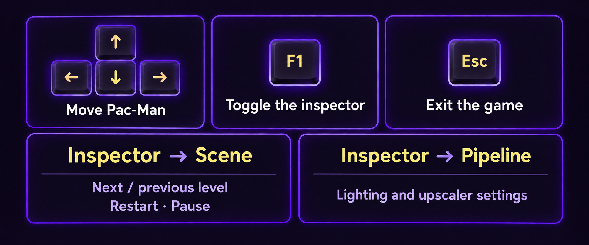
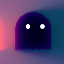
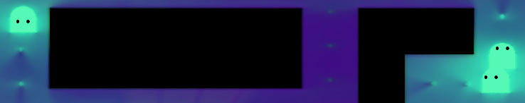

<h1 align="center">Raytracing Pac-Man</h1>

<p align="center">
  <a href="https://github.com/lestercorderomurillo/raytracing-pacman/releases/tag/v0.1.0"></a>
  
</p>

[](docs/screenshots/gameplay-maximized.png)

Collect every coin to advance. Power pellets let you eat frightened ghosts; getting caught restarts the level.

- **Six levels:** a classic maze and five seeded layouts with different colors and ghost lineups.
- **Seven ghost types:** Blinky, Pinky, Inky, Clyde, Dinky, Shadow, and Rainbow.
- **Dynamic lighting:** glowing walls, ghosts, coins, and power pellets.

## Play

**[Download v0.1.0 for Linux x64](https://github.com/lestercorderomurillo/raytracing-pacman/releases/download/v0.1.0/raytracing-pacman-v0.1.0-linux-x64.tar.gz)** · [Release notes](https://github.com/lestercorderomurillo/raytracing-pacman/releases/tag/v0.1.0)

```sh
tar -xzf raytracing-pacman-v0.1.0-linux-x64.tar.gz
cd raytracing-pacman-v0.1.0-linux-x64
./raytracing-pacman
```

Requires Linux x64, Vulkan graphics drivers, and a graphical desktop. Keep the bundled runtime and assets with the executable.

## Controls

[](docs/controls.png)

## Ghosts

| Blinky | Pinky | Inky |
| :---: | :---: | :---: |
|  |  |  |
| Direct pursuit; retreats to the upper-right corner. | Direct pursuit; retreats to the upper-left corner. | Direct pursuit; retreats to the lower-right corner. |

| Clyde | Dinky | Shadow |
| :---: | :---: | :---: |
|  |  |  |
| Chases from afar; retreats when Pac-Man gets close. | Heads for random corners when Pac-Man gets close. | Dark body; moves up to 50% faster. |

**Rainbow**



Splits into three color-changing ghosts, then merges back into one.

[Build and test instructions](BUILD.md). Built with [Radiant](https://github.com/lestercorderomurillo/radiant-game-engine) and MonoGame DesktopVK.
